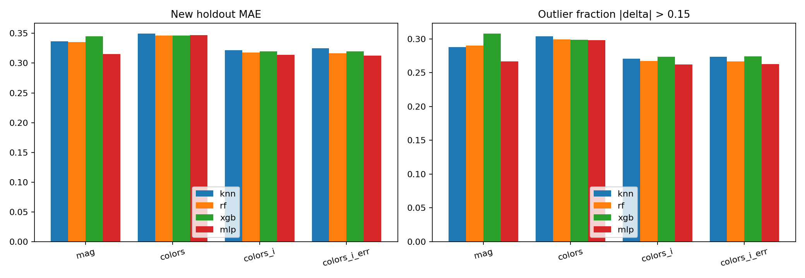

# SDSS 类星体测光红移估计

**Reproducible photometric-redshift experiments with leakage-aware model selection and distribution-shift analysis.**

基于 SDSS DR16Q 的真实天文数据，构建从 FITS 数据校验、对象去重、特征处理、交叉验证到独立测试、异常案例分析和模型重载验证的完整机器学习实验流程。该仓库整理已完成的 V2 实验，源码与正式运行记录中的版本摘要一致。

## 主要结果

- 数据：原始目录 **750,414** 个对象；开发集 **170,000** 个对象；全新的独立保留测试集 **30,000** 个对象。
- 选模：固定 **50,000** 个开发对象做三折交叉验证，对比 **kNN、随机森林、XGBoost、PyTorch MLP** 与两种常数基线；四组输入为五星等、四颜色、四颜色+i 星等、四颜色+i 星等+五波段误差。
- 按开发集 CV MAE 预选的主模型为 **MLP + colors_i_err**。新测试集 **MAE 0.31261、RMSE 0.47963、NMAD 0.09267、离群率 26.27%**；相对中位数基线的 MAE 降低约 **48.1%**。
- 控制两臂各 **50,000** 个训练样本，在同一批 **20,289** 个暗源上评估亮度偏移。MLP 仅亮源训练 MAE **0.38664**，混合亮度训练 MAE **0.32990**。该差异反映选择偏移，不能单独归因于亮度的因果效应。
- 已有正式验证记录中，**18 个最终模型及 8 个偏移模型**均通过保存后重载预测一致性检查。

完整证据：[实验报告](results/RESULTS.md) · [测试指标](results/metrics_test.csv) · [CV 汇总](results/cv_summary.csv) · [特征对照](results/feature_ablation.csv) · [重载验证](results/reload_check.json)



## 实验设计

1. 校验原始 FITS 的大小、字段与 SHA256，清洗测光无效值并进行银河系消光改正。
2. 使用 SDSS_NAME / THING_ID 关联身份去重。V2 新测试集排除 V1 全部 200,000 个对象及其关联身份，避免复用已观察的旧测试集。
3. 每折仅用训练数据拟合缺失值填补与标准化。XGBoost/MLP 在外层训练折内部划分早停集，再用选定步数重训整个外层训练折。
4. 根据三折平均 MAE 选参，用全部开发集训练最终模型；在首次测试前冻结配置、数据和模型哈希，测试打开后禁止继续训练。
5. 分析红移/亮度分段误差、特征表示、异常对象及开发集颜色近邻，并提供 CSV 推理入口。

## 运行与复现

- [复现指南](docs/REPRODUCING.md)：已有数据复用、从官方 FITS 重建数据、训练与验证命令。
- [原始 V2 使用说明](docs/EXPERIMENT_GUIDE.md)：详细设计、阶段命令及故障处理。说明中的原目录布局为历史运行布局，克隆本仓库请优先使用复现指南。
- [仓库核验记录](docs/VERIFICATION.md)：此次打包时的测试和版本检查范围。

```powershell
python -m pip install -r requirements.txt
python -m unittest discover -s tests -v
python v2.py --help
```

以上合同测试无需下载原始目录或启动训练。正式模型训练还需安装适合硬件的 PyTorch；实际实验环境为 Python 3.11.18 / PyTorch 2.9.1+cu130，其余版本见 [run.json](results/run.json)。requirements.txt 不会自动替换 PyTorch。

## 目录

```text
v2.py                  V2 命令行入口
photoz2/               数据、模型、实验调度、评估与推理
configs/               正式与 smoke 配置
tests/                 科学实验约束的单元测试
results/               实际汇总指标、图表与小型溯源文件
docs/                  复现和核验说明
legacy/v1/             重建原始划分所需的 V1 实现
```

## 边界与数据管理

这是针对已确认类星体的同目录保留测试，不是类别识别、概率红移校准、跨巡天泛化或已部署的数据平台。CV 三折标准差不是置信区间。V1 与 V2 测试对象不同，不能把两版成绩差异当作纯模型改进。离群定义为 |(z_pred-z_spec)/(1+z_spec)| > 0.15。

仓库不包含原始 FITS、处理后的逐对象数组、全量预测、模型权重、虚拟环境或日志。results 中的冻结与评估记录会引用这些未打包文件的哈希，它们用于溯源，不能据此认为模型权重已随仓库提供。cases.csv / case_neighbors.csv 仅含来自公开天文目录的少量诊断对象，不是个人信息。

数据来源：[SDSS DR16Q](https://www.sdss4.org/dr17/algorithms/qso_catalog/)；Lyke et al. (2020), ApJS 250, 8, [doi:10.3847/1538-4365/aba623](https://doi.org/10.3847/1538-4365/aba623)。请遵守 SDSS 的数据使用与致谢要求。本仓库未添加开源许可证；公开发布和许可选择需由所有者另行决定。
