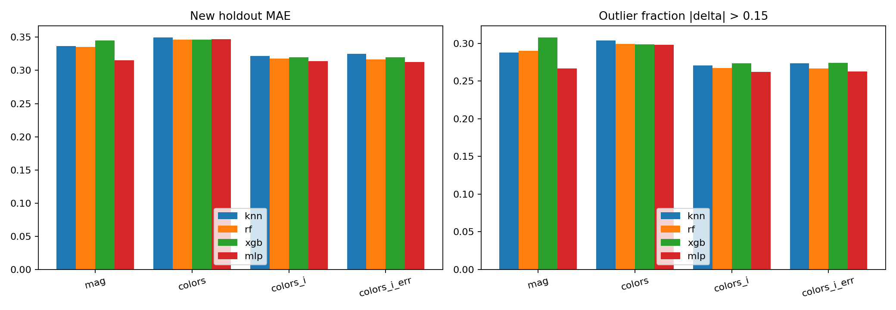
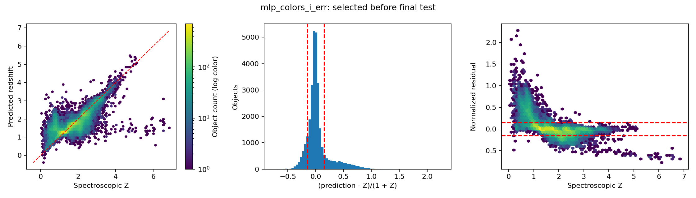
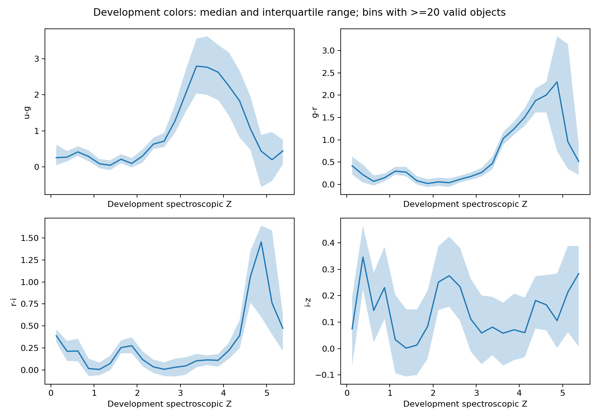

# SDSS DR16Q V2 实验结果

实验用途：FORMAL_EXPERIMENT。
开发集 170,000 个对象；新的保留测试集 30,000 个对象。
新测试集排除了 V1 的全部 200,000 个对象及关联重复身份。
三折交叉验证使用固定开发子集：50,000 条。
测试前按开发集 CV MAE 选定的主模型：mlp_colors_i_err。
CV 分数用于开发选模；三折标准差不是置信区间，也不是多次独立训练种子的误差估计。
早停只使用各外层训练折的内部划分；随后按选出的步数在整个外层训练折重训。
最终模型使用全部开发数据，训练步数取入选配置三个折内最佳步数的中位数。

| 模型 | CV MAE 均值 | CV 标准差 | 新测试 MAE | RMSE | NMAD | 离群率 |
|---|---:|---:|---:|---:|---:|---:|
| median | 0.60320 | 0.00180 | 0.60270 | 0.74958 | 0.28398 | 61.79% |
| mean | 0.60403 | 0.00196 | 0.60374 | 0.74783 | 0.28904 | 61.37% |
| knn_mag | 0.35363 | 0.00220 | 0.33666 | 0.50421 | 0.10397 | 28.80% |
| knn_colors | 0.35190 | 0.00233 | 0.34981 | 0.52033 | 0.10544 | 30.36% |
| knn_colors_i | 0.32903 | 0.00200 | 0.32198 | 0.49015 | 0.09522 | 27.05% |
| knn_colors_i_err | 0.33129 | 0.00118 | 0.32469 | 0.49665 | 0.09534 | 27.36% |
| rf_mag | 0.34999 | 0.00220 | 0.33516 | 0.49942 | 0.10302 | 29.04% |
| rf_colors | 0.35038 | 0.00197 | 0.34614 | 0.51709 | 0.10316 | 29.94% |
| rf_colors_i | 0.32352 | 0.00203 | 0.31755 | 0.48817 | 0.09230 | 26.74% |
| rf_colors_i_err | 0.32285 | 0.00153 | 0.31628 | 0.48566 | 0.09171 | 26.69% |
| xgb_mag | 0.35738 | 0.00297 | 0.34510 | 0.50024 | 0.11296 | 30.80% |
| xgb_colors | 0.35035 | 0.00223 | 0.34646 | 0.51485 | 0.10415 | 29.86% |
| xgb_colors_i | 0.32499 | 0.00220 | 0.31957 | 0.48480 | 0.09548 | 27.34% |
| xgb_colors_i_err | 0.32521 | 0.00158 | 0.31946 | 0.48365 | 0.09583 | 27.41% |
| mlp_mag | 0.32314 | 0.00233 | 0.31513 | 0.48214 | 0.09120 | 26.66% |
| mlp_colors | 0.34958 | 0.00526 | 0.34710 | 0.51392 | 0.09942 | 29.79% |
| mlp_colors_i | 0.31708 | 0.00135 | 0.31393 | 0.48249 | 0.09309 | 26.19% |
| mlp_colors_i_err | 0.31703 | 0.00234 | 0.31261 | 0.47963 | 0.09267 | 26.27% |

归一化残差 delta=(预测红移−光谱红移)/(1+光谱红移)。离群：|delta|>0.15。
NMAD=1.4826×median(|delta−median(delta)|)。预测未裁剪。
四颜色+i 星等在完整测光时与五星等包含相同信息；表示方式不同。
存在缺失值时，派生特征后分别填补可能破坏这种精确等价关系。

## 亮度偏移对照

阈值为消光改正后的 i=20.0；每个训练臂 50,000 个对象。
两臂在完全相同的 20,289 个暗源测试对象上评估。
| 模型 | 仅亮源训练 MAE | 混合亮度训练 MAE | 前者减后者 |
|---|---:|---:|---:|
| knn | 0.41572 | 0.34520 | 0.07052 |
| rf | 0.42496 | 0.33503 | 0.08993 |
| xgb | 0.39965 | 0.33361 | 0.06604 |
| mlp | 0.38664 | 0.32990 | 0.05674 |

训练样本量、特征、超参数和最终评估对象保持一致。该实验改变亮度选择，同时也可能改变红移等分布。
## 异常对象

抽取 20 个离群案例和 20 个正常对照。
cases.csv 包含测光、测量误差、标签来源、各模型预测与开发集颜色近邻摘要。
case_neighbors.csv 只包含开发集近邻。邻居红移分散是待调查线索，不是物理原因的证明。
ZWARNING 只作为诊断元数据；不能据此自动否定可能经过人工修正的主红移。

## 范围

结果仅适用于本次筛选出的同目录类星体分布，不证明跨巡天泛化。
V1 测试结果与 V2 的新测试结果来自不同对象，不能把二者差值当作纯模型提升。
模型文件与预处理器在上级 trials/final_* 和 trials/shift_* 中；报告目录本身不含权重。
reload_check.json 由独立 verify 命令生成；生成报告不等于该命令已执行。

